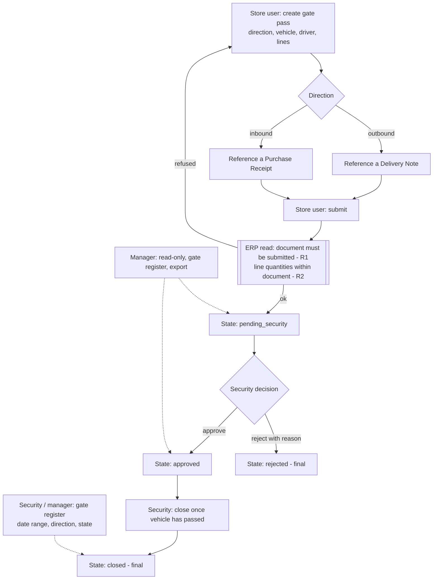

# Process map: Gate Pass

Who acts: **store_user** creates, edits own draft, submits. **security** approves, rejects (reason required), closes.
**manager** reads and exports only. The ERP is only read (Delivery Note, Purchase Receipt); nothing is written back.
The rules R1 and R2 run only while the pass is a draft (create, edit, submit); the app re-reads the ERP each time. Once the pass is pending with security the ERP is no longer consulted, so approve, reject and close always work.
